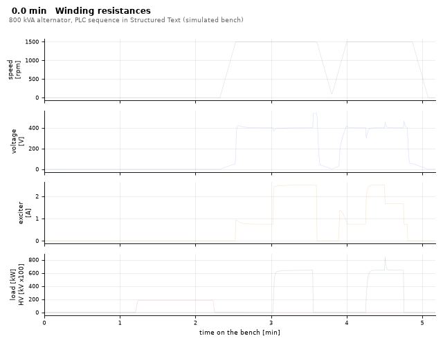
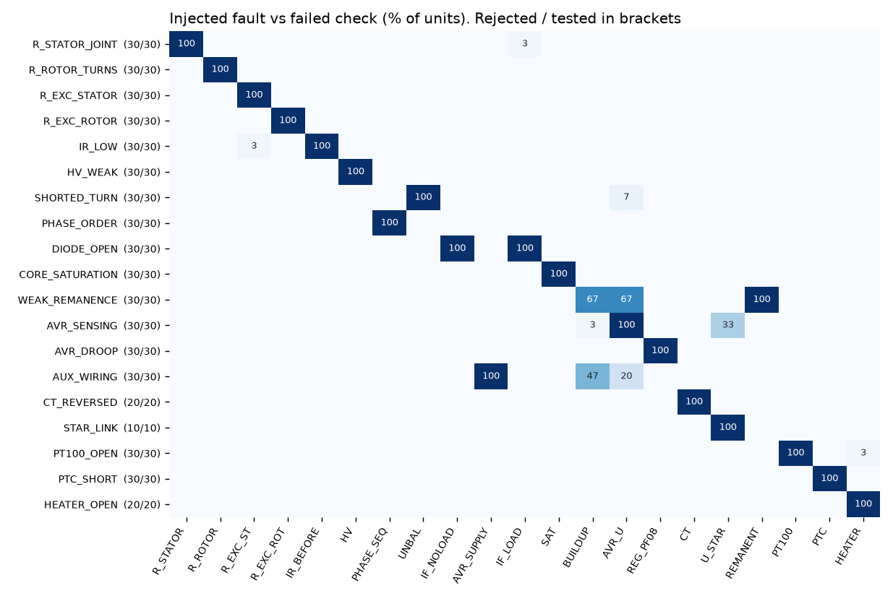
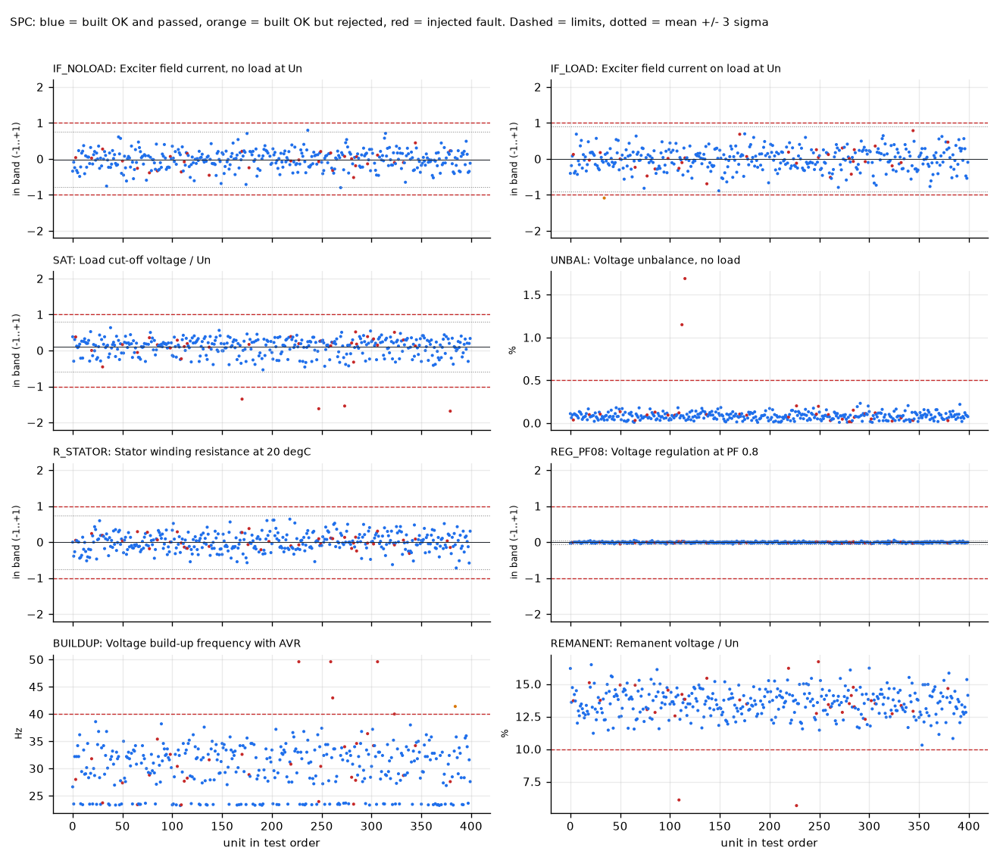
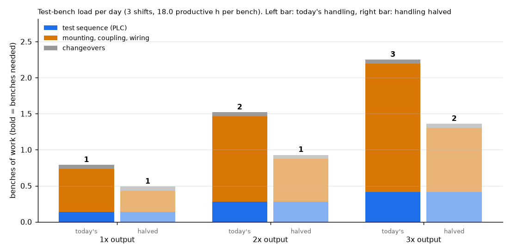
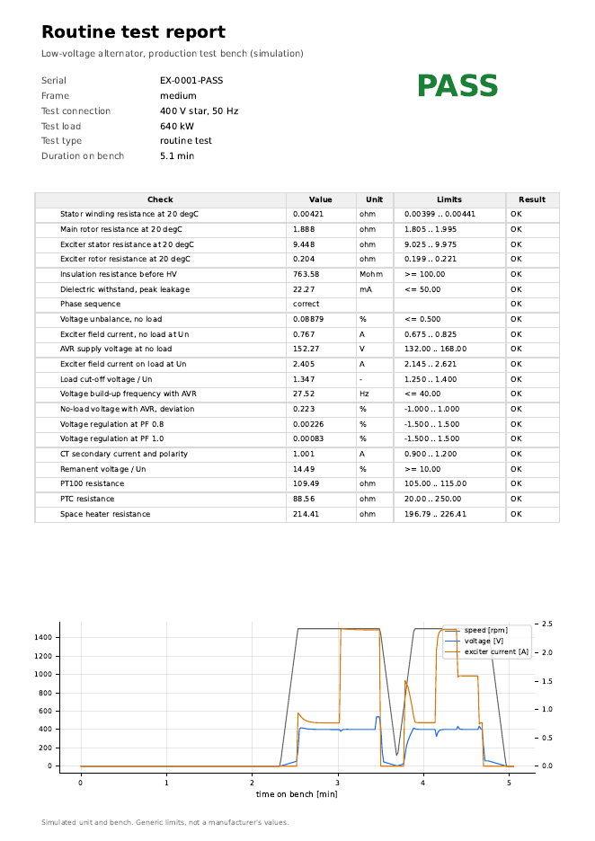
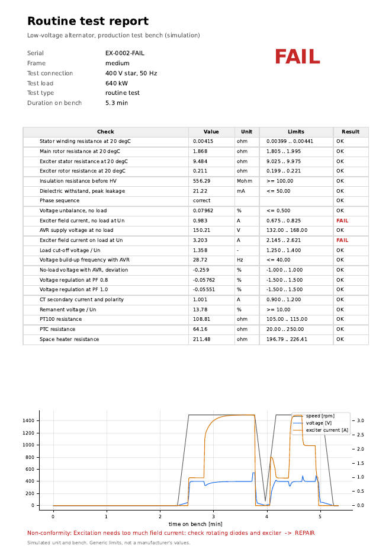

# Alternator routine-test station (simulation)

[](https://github.com/chad416/alternator-routine-test-station/actions/workflows/ci.yml)

An automated production test for low-voltage synchronous alternators: the test bench's PLC sequence, the recipe that comes with each production order, a digital test report per serial number, non-conformity routing, statistics across all units, and how many test benches a plant needs as output grows.

- **The PLC code is real Structured Text (IEC 61131-3).** It is compiled with [matiec](https://github.com/beremiz/matiec), the compiler behind OpenPLC and Beremiz, and runs scan by scan against a simulated alternator and bench, locally and in CI.
- **A Siemens version is generated from the same source.** [`plc/scl/RoutineTest.scl`](plc/scl/RoutineTest.scl) is a TIA Portal SCL external source. It has not been compiled in TIA yet; see [Limits](#limits).

**Everything here is simulated.** The alternator, bench, limits and fault rates are models and assumptions, not data from any manufacturer.



## What the sequence does

One function block, [`ROUTINE_TEST`](plc/st/routine_test.st), with 25 checks. Which of them apply comes from the order: CT fitted, space heater, 690 V machine tested in delta, type test.

| Stage | Checks |
|---|---|
| At rest | Four winding resistances, corrected to 20 °C (copper, k = 235) · insulation resistance at 60 s · dielectric withstand at 1000 V + 2 Un (IEC 60034-1) for 60 s · insulation again after HV (type test) |
| Run-up, external DC excitation | Field current for rated voltage at no load · phase sequence · voltage unbalance · AVR supply voltage |
| On load, PF 0.8, external excitation | Field current for rated voltage, held for the load cut-off: saturated voltage / Un |
| De-excite, stop, run-up with the AVR | Frequency at which the voltage builds up · no-load voltage with AVR |
| On load with the AVR | Voltage regulation at PF 0.8 and 1.0 · CT secondary current and polarity · 150 % overload for 30 s (type test) |
| Delta to star (690 V machines) | Star voltage after reconnection, de-excited before switching |
| Open excitation | Remanent voltage |
| Type test | 120 % overspeed for 2 min |
| At rest | PT100, PTC, space heater |

It also handles the things a real bench needs:
- **Interlocks:** high voltage and the megger only with the gate closed and the rotor at rest; the drive never runs while HV is applied; load and excitation only while running.
- **Aborts:** E-stop, gate opened, bench or drive fault, operator abort, and a timeout on every step. Each one sets a code and puts the bench in a safe state in the same scan.
- **Stopping early:** a failed insulation test stops the run before HV or rotation. An AVR that builds no voltage skips the load points.
- **Large machines:** if a unit is larger than the bench can load (2500 kVA against a 1500 kW bench), it is tested at bench load and the report says so.

The full step list and state diagram are in [docs/sequence.md](docs/sequence.md).

## Results

From `scripts/run_all.sh` (numbers in [results/summary.json](results/summary.json)).

**Fault detection.** 19 faults were injected, each 10 times on every frame where it can occur: 530 units.

- All 530 were rejected.
- In all 530 the check designed for that fault was among the failed ones.
- No run aborted.



Some faults trip more than one check, as they would on a real bench:
- An open rotating diode fails both field-current checks.
- Weak remanence also fails build-up on self-excited machines, but not on the PMG-excited large frame.
- An AVR sensing error also shows up in the star voltage.

**Production mix: 400 units** (50 % small, 30 % medium, 20 % large; 39 with one injected fault).

| | |
|---|---|
| Passed | 359 |
| Faulty units that passed (escapes) | **0** of 39 |
| Good units rejected (false rejects) | **2** of 361: one at −10.9 % on-load field current (limit ±10 %), one with voltage build-up at 41.4 Hz (limit 40 Hz) |
| Aborted runs | 0 |
| PLC decisions that disagree with an independent Python re-evaluation | **0** (also 0 in the 530-unit sweep) |

The two false rejects are real tolerance-edge cases, and they fit the capability figures below.



**Capability of good units** (Cpk; below 1.33 means rejects will happen):
- **IF_LOAD 1.06–1.13:** the on-load field current depends on the armature reaction and saturation spread, so ±10 % is tight. The false reject above comes from this.
- **PT100 0.97–1.09:** a fixed 105–115 Ω band covers ambient temperatures of only about 13–38 °C. The limit should follow the measured ambient instead.
- **REMANENT 1.10–1.21:** residual magnetism varies a lot. On self-excited machines it also decides the build-up check.
- **HEATER 1.05–1.15:** ±7 % on an element with about 2 % spread.
- **All the others are at 1.13 or above.** The four resistances are 1.13–1.73.

**Time on the bench** (PLC sequence of passed units; simulated settle times):

| Frame | Routine test | Type test |
|---|---|---|
| small, 100 kVA | 4.2 min | 7.8 min |
| medium, 800 kVA | 5.1 min | 8.7 min |
| large, 2500 kVA | 7.2 min | not possible on this bench |

**How many test benches?** Base demand is 20 small, 6 medium and 4 large units per day. Other assumptions (in [config/capacity.json](config/capacity.json)): handling, meaning mounting, coupling, wiring and removal, takes 15, 25 and 40 min per unit; there are 3 shifts at 80 % availability, 5 % retests and 6 frame changeovers a day.

| Output | Bench hours / day | Benches needed | With handling halved |
|---|---|---|---|
| 1× | 14.2 | 1 | 1 |
| 2× | 27.3 | 2 | 1 |
| 3× | 40.5 | 3 | 2 |



**Handling dominates, not the test itself.** About 3/4 of the bench time is mounting, coupling and wiring, under these assumptions. Quick-connect fixtures (an SMED-style change) save a whole bench at 2× and 3× output. A faster sequence would save much less.

The per-frame times go to the sister project, [generator-plant-rampup-sim](https://github.com/chad416/generator-plant-rampup-sim), through [results/test_times.json](results/test_times.json).

## Records

Each unit gets:
- a **PDF report** and a **JSON record** under its serial number;
- a row in an **SQLite** test database (units, results and non-conformities: a stand-in for an MES);
- if it failed, a **non-conformity** with the likely cause and the place it goes next (repair, drying, re-test, rework, engineering).

| Passed | Failed: open rotating diode |
|---|---|
|  |  |

Sample files: [docs/examples/](docs/examples/).

## How it works

```
 production order ──► recipe (station/recipe.py) ──┐
                                                   ▼
 bench measurements ──► ROUTINE_TEST (ST, compiled by matiec → librt.so) ──► bench commands
        ▲                                                                          │
        └──────────── simulated alternator + test bench (station/plant.py) ◄───────┘
                                 every 20 ms PLC scan
```

- **Plant model** ([station/plant.py](station/plant.py)):
  - Saturation curve E = (1 + c)·x / (c + x).
  - Brushless excitation with a field time constant.
  - On-load field current by the ASA method; terminal voltage found by bisection for a constant-impedance load bank.
  - Remanence, a generic V/f AVR that self-excites only above a minimum supply, megger polarisation, HV leakage from winding capacitance, PT100 to IEC 60751, meter noise and manufacturing spread.
- **Faults** ([station/plant.py](station/plant.py), `FAULTS`): 19 kinds, each a physical change to the unit, such as a resistance factor, a diode loss factor or a weak core. None is a flag the PLC can read.
- **Cross-check** ([station/checks.py](station/checks.py)): every pass/fail decision is recomputed in Python from the latched values and the recipe.
- **Harness:**
  - [plc/gen_shim.py](plc/gen_shim.py) reads the function block's I/O from the ST source and writes a small C shim. Python drives it through `ctypes`.
  - [plc/st_to_scl.py](plc/st_to_scl.py) produces the TIA Portal SCL file from the same source.
  - A test checks that the SCL file is up to date.

## Run it

Linux or WSL with gcc, Python 3.12 and a matiec build:

```bash
git clone https://github.com/beremiz/matiec ~/matiec && cd ~/matiec && autoreconf -i && ./configure && make
pip install -r requirements.txt
bash scripts/build_plc.sh                     # ST -> C -> build/plc/librt.so
python -m pytest -q                           # 84 tests
python -m station test --frame large --fault STAR_LINK --serial U-1
python -m station batch && python -m station sweep && python -m station analyse
bash scripts/run_all.sh                       # everything, regenerates all results and images
```

Simulating one unit takes about 0.3 s. The 400-unit batch takes 32 s on 15 worker processes.

## Tests

84 pytest tests:
- **Plant physics:** saturation curve, ASA consistency, IEC test voltage, PT100.
- **Every fault on every frame:** each must be rejected by its check.
- **Interlocks:** HV removed in the same scan when the gate opens; E-stop drops the drive, load and excitation; step timeout; no start without the operator checks; HV, drive and load never overlap; abort, reset and a new start.
- **Cross-check:** PLC vs Python on a sweep.
- **Records and reports.**
- **Cpk and capacity arithmetic** against hand calculations.
- **SCL:** the file is up to date and uses the TIA dialect.

The requirement-to-test map is in [docs/traceability.md](docs/traceability.md), and the requirements in [SPEC.md](SPEC.md).

## Limits

- **Simulated alternator and bench.** The machine model is steady-state with first-order dynamics: no transient reactances, no thermal model, no harmonics. Settle times are seconds, not the minutes a real heat-stable reading takes, so the sequence times above are lower bounds.
- **Generic limits.** The recipe values are illustrative and chosen to be self-consistent with the model; they are not a manufacturer's test specification. Real limits come from the works order.
- **The SCL file is not compiled.** It is generated from the tested ST source, but TIA Portal is not part of CI. The next step is to import it into TIA Portal (S7-1500) and run it against PLCSIM.
- **Not the whole bench.** There is no operator HMI, no safety PLC (the interlocks here are functional, not SIL/PL-rated), and no real instrument drivers. Phase-sequence relay, CT polarity and HV trip are modelled as digital inputs.
- **Assumed capacity inputs.** Handling times, demand and availability are assumptions. The capacity result depends on them, which is why the chart shows two handling cases.

## Licence

MIT, see [LICENSE](LICENSE).
