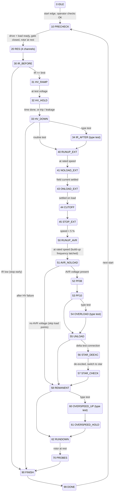

# Sequence

Step numbers as in `plc/st/routine_test.st` (`S_*` constants). From any busy step, an abort condition goes to `ABORTED (900)`, which needs a reset to return to `IDLE`.

## Output stage (every scan, after the step logic)

1. In IDLE, DONE, FINISH and ABORTED, all outputs go to their safe values.
2. HV and the megger are only allowed with the gate closed and the speed below 1 rpm.
3. The drive is only allowed with HV and the megger off and the HV source discharged.
4. Load and excitation are only allowed with the drive running.
